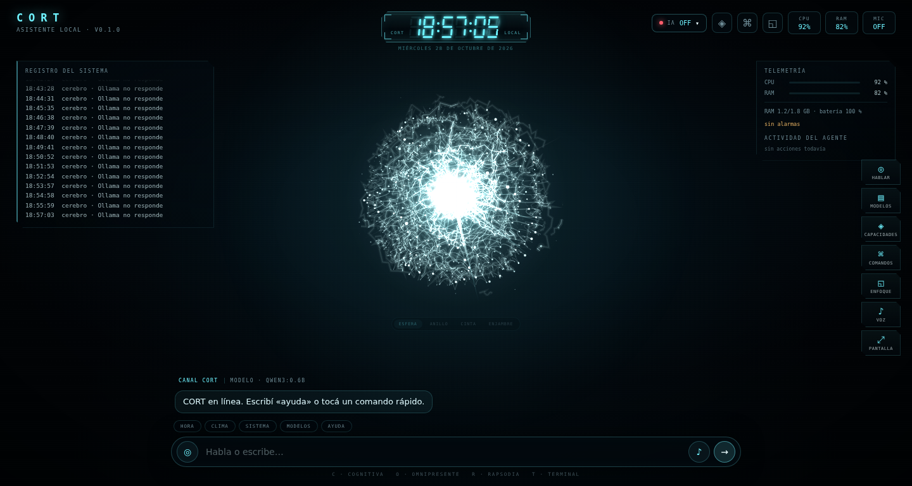
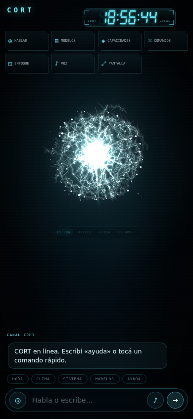

# CORT

**Cognitiva · Omnipresente · Rapsodia · Terminal**

Asistente personal local para Linux, con HUD propio, memoria persistente y voz en español.
Funciona sin conexión para los comandos del día a día y usa Ollama cuando está disponible para
conversar y razonar paso a paso.




> Captura real del HUD. En una ventana de escritorio se suman el registro del sistema (izquierda),
> la telemetría (derecha) y el rail de acciones; en ventanas angostas se ocultan los paneles y el
> rail pasa a fila o a rejilla táctil.



> La misma página a 390×844: el rail se convierte en una rejilla de cuatro columnas con etiqueta.

## Índice

- [Qué es](#qué-es)
- [Estado verificado](#estado-verificado)
- [Instalación paso a paso](#instalación-paso-a-paso)
- [Uso](#uso)
- [Comandos](#comandos)
- [Arquitectura](#arquitectura)
- [HUD](#hud)
- [Voz](#voz)
- [Arnés de agentes](#arnés-de-agentes)
- [Memoria y datos](#memoria-y-datos)
- [Configuración](#configuración)
- [Pruebas](#pruebas)
- [Límites y seguridad](#límites-y-seguridad)
- [Hoja de ruta](#hoja-de-ruta)
- [Licencia](#licencia)

## Qué es

CORT es un asistente que corre en tu propia computadora. El router entiende frases cortas en
español y resuelve los comandos frecuentes sin depender de internet ni de un modelo de lenguaje:
hora, fecha, clima, estado del sistema, alarmas, memoria, apuntes locales, apps permitidas,
búsquedas, música y control de reproducción. Cuando la frase no es un comando conocido, consulta
Ollama; si Ollama no está encendido, lo dice con claridad en lugar de inventar.

El HUD es una página local servida por CORT. Se puede abrir en el navegador o en una ventana
nativa si `pywebview` está instalado. La voz usa `espeak-ng` y la escucha es opcional con Vosk en
español; sin esos componentes, el chat escrito sigue funcionando.

Documentación de diseño: [PROMPT-MAESTRO](docs/PROMPT-MAESTRO.md),
[ARQUITECTURA](docs/ARQUITECTURA.md), [DECISIONES](docs/DECISIONES.md),
[ANÁLISIS DEL HUD](docs/ANALISIS-HUD.md) y [ROADMAP](docs/ROADMAP.md).

## Estado verificado

Comprobado en este equipo (Debian, Python 3.13.5, 2 núcleos, 1,8 GiB de RAM) el **28 de octubre de 2026**:

| Comprobación | Resultado |
| --- | --- |
| Suite de pruebas | **147 pruebas unittest en verde** |
| CLI | `--version`, `--once`, `--doctor`, `--hud`, `--no-abrir` |
| HUD | reloj cinematográfico, orbe con 4 estilos, 9 estados, animación de ejecución, chat, rail de acciones, panel de capacidades, paleta de comandos, panel de modelos, arranque y diseño adaptable con PWA |
| Modelos Ollama | listado real, selección persistida, recomendados, descarga con progreso y cancelación, y auto-selección al terminar |
| Descarga real | `gemma3:270m`, 278 MB en 66 s, con porcentaje agregado por capas y verificación SHA-256 |
| Inferencia real | `qwen2.5:0.5b` respondió por CORT con el prompt compacto; tardó 269 s en este portátil |
| Clima real | por IP y por ciudad, con `ip-api.com` + `open-meteo.com` |
| Memoria | guardar nombre, consultar y sobrevivir entre ejecuciones (SQLite) |
| Alarmas | hora con `6:30`, mensaje y rechazo honesto si falta la hora |
| Apuntes | lectura de `knowledge/` con búsqueda por palabras |
| VLC real | reproducción de un WAV con `cvlc`, pausa con SIGSTOP y reanudación con SIGCONT |
| Apps reales | apertura de `galculator` desde la allowlist y cierre posterior |
| Diagnóstico | `scripts/install.sh` y `python3 -m cort --doctor` |

Lo que **no** se probó todavía, y por eso no se anuncia como funcionando:

- Inferencia cómoda: en este portátil (2 núcleos, 1,8 GiB) una respuesta de `qwen2.5:0.5b` puede
  tardar minutos si Qoder o el navegador están abiertos. Funciona, pero no es conversación fluida.
- Modelos diminutos: `gemma3:270m` descarga bien, pero respondió incoherencias; por eso no está en
  las recomendaciones del panel.
- Voz y palabra de activación: faltan el paquete `vosk` y el modelo en español.
- HUD en el teléfono: la página se adapta y tiene manifest, pero no se probó la instalación PWA
  en el A16 ni el acceso por red local. Sin HTTPS, el navegador puede limitar «Agregar a inicio».
- Gestos con cámara: planificados, no implementados.
- Ventana nativa: falta `pywebview`; el HUD se abre en el navegador.
- `playerctl`: no está instalado; pausa, reanudación y cambio de pista usan señales y el estado
  guardado por CORT, lo que funciona con VLC pero no da posición exacta.

## Instalación paso a paso

Requisitos: Linux con Python 3.11 o superior. En Debian/Ubuntu:

```bash
sudo apt install python3 python3-psutil python3-requests \
                 espeak-ng vlc xdg-utils libnotify-bin alsa-utils
```

1. Entrá a la carpeta del proyecto:

   ```bash
   cd ~/Vídeos/CORT
   ```

2. Comprobá el entorno. Este guion **no instala nada**: sólo revisa y te dice qué falta.

   ```bash
   ./scripts/install.sh
   ```

3. Probá una respuesta sin abrir el HUD:

   ```bash
   ./scripts/run.sh --once "¿qué hora es?"
   ```

4. Arrancá el modo consola:

   ```bash
   ./scripts/run.sh
   ```

   Escribí `ayuda` para ver los comandos y `salir` para terminar.

5. Arrancá con el HUD:

   ```bash
   ./scripts/run.sh --hud
   ```

   Se abre en una ventana nativa si `pywebview` está instalado; si no, en el navegador. La dirección
   por defecto es `http://127.0.0.1:8765/`.

6. Opcional, arranque automático al iniciar sesión:

   ```bash
   ./scripts/install-autostart.sh
   ```

   Para quitarlo: `./scripts/install-autostart.sh --quitar`.

### Voz opcional

```bash
python3 -m venv .venv
.venv/bin/pip install vosk
./scripts/fetch-vosk-es.sh
./scripts/run.sh --hud --voz
```

El modelo pequeño de español pesa 39 MB y se descarga desde el sitio oficial de Vosk. Si usás el
entorno virtual, arrancá CORT con `.venv/bin/python -m cort --hud --voz` o activá el entorno antes
de `./scripts/run.sh`.

### Ollama opcional

Si Ollama ya está instalado y encendido en `http://127.0.0.1:11434`, CORT elige el modelo configurado
y, si no está, un respaldo o el más pequeño disponible. Los modelos se configuran en
`config/cort.toml`; por defecto: `qwen3:0.6b`, `qwen2.5:0.5b` y `qwen3.5:2b` como modelo profundo.

El chip **IA** del HUD abre un panel con los modelos instalados, cuatro recomendaciones según la
RAM, el modelo activo y una descarga con progreso real (`ollama pull`): porcentaje agregado por
capas, MB, velocidad, tiempo restante y botón **cancelar**. La descarga sigue en segundo plano si
cerrás el panel y, al terminar, CORT selecciona el modelo descargado. También se puede hacer por
chat:

| Frase | Qué hace |
| --- | --- |
| `¿qué modelos de Ollama tienes?` | lista nombre, tamaño y modelo activo |
| `descarga el modelo qwen3:0.6b` | descarga con progreso visible |
| `usa el modelo qwen2.5:0.5b` | valida que exista y lo deja activo |
| `cancela la descarga` | detiene la descarga en curso |

Para que un modelo pequeño alcance, CORT usa un prompt compacto cuando detecta nombres como
`0.5b`, `0.6b` o `1b`, recorta `num_predict` y reenvía los últimos turnos de la conversación
(configurable con `historial_mensajes`). El texto parcial del modelo aparece bajo el orbe mientras
se genera. Si el modelo no está, CORT prueba el respaldo y, si tampoco hay, responde con los
comandos directos en lugar de inventar.

> En este portátil conviene no tener Ollama, el navegador y pruebas pesadas al mismo tiempo: la
> memoria es limitada. CORT funciona igual para los comandos directos.

## Uso

- **Consola:** `./scripts/run.sh` y escribí tus frases.
- **HUD:** `./scripts/run.sh --hud`. El chat está abajo; los botones redondos activan el micrófono
  y el silencio de la voz.
- **Una sola frase:** `./scripts/run.sh --once "clima en Caracas"`.
- **Diagnóstico:** `./scripts/run.sh --doctor`.
- **Sin voz:** agregá `--sin-voz`.
- **Sin abrir ventana:** agregá `--no-abrir`; imprime la URL para abrirla a mano.
- **Otro puerto:** `--puerto 9000`.
- **Otra configuración:** `--config ruta/a/cort.toml`.

## Comandos

| Frase | Qué hace |
| --- | --- |
| `hola` | saludo |
| `¿qué hora es?` / `¿qué día es hoy?` | hora y fecha reales del sistema |
| `cómo está la PC` | CPU, RAM, disco y batería con `psutil` |
| `clima` / `clima en Caracas` | clima real; si no hay red, lo dice y no inventa |
| `me llamo Sandra` | guarda el nombre en SQLite |
| `mi hermana se llama Ana` / `vivo en Caracas` | guarda familiares y ciudad |
| `recuerda que la práctica es el jueves` | guarda una nota |
| `¿cómo me llamo?` / `memoria` | consulta lo guardado |
| `olvida mi color favorito` | borra hechos que coincidan |
| `abre la calculadora` | abre sólo apps de la allowlist |
| `abre VLC` | abre VLC desde la allowlist |
| `abre YouTube` / `abre WhatsApp` | abre sitios permitidos |
| `busca en Google …` / `busca en YouTube …` | búsqueda en el navegador |
| `reproduce …` | busca en tus carpetas y, si no está, abre YouTube |
| `música` | reproduce hasta 50 archivos de `~/Música` |
| `pausa` / `reanuda` / `siguiente` / `anterior` | control de reproducción |
| `sube el volumen` / `baja el volumen` | volumen del sistema con `pactl` |
| `alarma a las 6:30 con ir a MORFO 3` | alarma con mensaje y notificación |
| `programa una alarma` | pide la hora en vez de suponerla |
| `¿qué sabes de la urea?` | busca en `knowledge/*.md` y `*.txt` |
| `¿qué modelos de Ollama tienes?` | lista modelos instalados y el activo |
| `descarga el modelo …` / `usa el modelo …` | descarga o cambia el modelo de Ollama |
| `usa el arnés para investigar …` | razonamiento por pasos (requiere Ollama) |
| `silencio` / `habla` | apaga o enciende la voz |

Las palabras de activación son **CORT** y **Sofi**; se pueden cambiar en `config/cort.toml`.

## Arquitectura

```text
cort/
├── __main__.py          CLI: --hud, --once, --doctor, --voz, --puerto…
├── app.py               orquestador: router → herramienta → memoria → bus → voz
├── router.py            intenciones deterministas en español
├── text.py              normalización, horas, fechas y similitud
├── config.py            TOML + valores por defecto
├── bus.py               estado compartido entre núcleo, HUD y voz
├── brain/
│   ├── memory.py        SQLite: hechos, episodios, alarmas y meta
│   ├── ollama.py        cliente HTTP con streaming y respaldo de modelo
│   ├── persona.py       personalidad, fecha real y reglas de honestidad
│   └── harness.py       arnés de agentes con contrato JSON
├── tools/               clima, sistema, apps, medios, búsquedas, alarmas,
│                        apuntes y memoria
├── voice/               espeak-ng (TTS) y Vosk + arecord (STT)
└── hud/
    ├── server.py        HTTP local y API
    └── static/          index.html, hud.css, hud.js (canvas 2D)
```

Flujo de una frase:

```text
texto → normalizar → router → herramienta (sin LLM)
                              └→ Ollama / arnés (si hace falta)
     → memoria de episodios → bus → HUD (polling) + voz (cola espeak-ng)
```

El servidor expone:

- `GET /api/estado`: reloj, estado, mensajes, métricas, alarmas, voz, progreso de descarga y texto
  parcial del modelo.
- `GET /api/salud`: comprobación mínima.
- `GET /api/modelos`: modelos instalados, activo, recomendados y estado de descarga.
- `POST /api/modelos/seleccionar`: `{"nombre": "qwen3:0.6b"}`.
- `POST /api/modelos/descargar`: `{"nombre": "qwen3:0.6b"}`, responde NDJSON con el progreso y un
  cierre con `activo`.
- `POST /api/modelos/cancelar`: cierra la descarga en curso.
- `GET /api/capacidades`: herramientas reales agrupadas por categoría, con riesgo y ejemplo.
- `POST /api/chat`: `{"texto": "..."}`.
- `POST /api/accion`: `silencio`, `detener`, `escuchar`, `pausa`, `reanudar`.

## HUD

- Reloj de siete segmentos en cian, con bisel de esquinas técnicas, etiquetas CORT/LOCAL y fecha
  en español.
- Orbe de filamentos luminosos como estilo por defecto (**esfera**): brazos que nacen del núcleo y
  estallan hacia el borde, cáscara de arcos irregulares, hebras interiores, polvo y un destello
  central descentrado. El resto de estilos sigue disponible: **anillo** vortex, **cinta** de
  plasma y **enjambre**.
- Nueve estados con color propio: reposo, escuchando, procesando, ejecutando, hablando,
  descargando, error, alarma y sin conexión. El color tiñe el orbe, el reloj, los paneles y los
  indicadores; en reposo el rótulo de estado se oculta para dejar limpio el orbe.
- Animación de ejecución: ráfaga de anillos y rayos alrededor del orbe, arcos punteados que
  preceden, toro de partículas y estrella de rayos en el núcleo; una tarjeta muestra la
  herramienta, la latencia y el avance, y el texto parcial del modelo aparece debajo.
- **Rail de acciones** a la derecha: hablar, detener el turno, modelos, capacidades, comandos,
  enfoque, voz y pantalla completa. Se compacta bajo la telemetría en ventanas de poca altura,
  pasa a fila horizontal en tablet y a rejilla de cuatro columnas con etiqueta en el teléfono.
- **Actividad del agente**: la traza muestra la herramienta real, una vista previa de sus
  argumentos, la duración y el error si lo hubo. Se alimenta del bus, no de texto inventado.
- **Capacidades**: panel con buscador, 16 herramientas agrupadas en 7 categorías, nivel de riesgo
  y un ejemplo que se carga en el compositor sin enviarse solo. Sale de `GET /api/capacidades`.
- **Paleta de comandos** (`Ctrl+K`/`⌘K`): diez acciones del HUD más los ejemplos de herramientas,
  con filtro sin tildes, flechas, `Enter` y `Esc`.
- **STOP real**: cancela el stream de Ollama, corta la voz y cierra el turno; el HUD lo refleja y
  no guarda una respuesta a medias. Está en el rail y en la cabecera del chat.
- **Arranque cinematográfico**: cuatro líneas de estado, se puede saltar y no se repite en la
  misma sesión.
- Chat con burbujas, metadatos de herramienta, chips rápidos, botón de parada y modo enfoque. La
  altura está acotada y el rótulo de estado vive justo bajo el orbe, así nada tapa la conversación.
- Panel de modelos con lista, selección, recomendados, descarga con progreso, cancelación y aviso
  de descarga en segundo plano.
- **PWA**: manifest, iconos 192 y 512, `theme-color` y metadatos de Apple. La instalación completa
  en el teléfono depende de HTTPS; ver [`docs/ANALISIS-HUD.md`](docs/ANALISIS-HUD.md).
- Sin dependencias de frontend: HTML, CSS y JavaScript puro. El ovillo se dibuja por lotes
  (`Path2D` agrupado por profundidad) y la calidad baja sola si un cuadro tarda demasiado; DPR
  limitado y respeto a `prefers-reduced-motion`.
- Pensado para bajo consumo: sin Electron, sin React y sin recursos remotos.

## Voz

- **Salida:** `espeak-ng` con la voz `es-mx+f3`, en un hilo y una cola propios. Limpia URLs y
  marcas de Markdown antes de hablar.
- **Entrada:** opcional con Vosk en español y `arecord` a 16 kHz mono. Detecta el final de la frase
  por silencio. Sin Vosk, el botón del micrófono explica el motivo exacto.
- **Activación:** «CORT» o «Sofi»; si la frase trae más texto, se responde directamente.

## Arnés de agentes

El arnés es una capa enchufable sobre las herramientas. El modelo debe responder con un JSON:

```json
{"tool": "clima", "args": {"ciudad": "Caracas"}}
```

o cerrar con:

```json
{"respuesta": "Texto final para la persona"}
```

Reglas: máximo 3 pasos, cada resultado vuelve al modelo, y se registran las trazas en el HUD. Si el
modelo no está disponible, el arnés lo dice y sugiere los comandos directos. El diseño está inspirado
en la idea de OpenClaw y HERMES-AGENT de la referencia, sin copiar código de terceros.

## Memoria y datos

- Base de datos: `~/.local/share/cort/cort.db` (o `$CORT_HOME/cort.db`).
- Hechos con clave y valor; los episodios se podan a 500 para no crecer sin control.
- Alarmas con hora ISO, mensaje y playlist opcional; se comprueban cada 15 segundos.
- Apuntes: `knowledge/*.md` y `*.txt`; `README.md` se ignora a propósito.
- Música: `~/Música`, con búsqueda por carpeta y por nombre de archivo.

## Configuración

Todo se ajusta en [`config/cort.toml`](config/cort.toml): palabras de activación, modelo y respaldo
de Ollama, voz, puerto del HUD, umbrales de aviso, allowlist de apps, rutas y límites del arnés.
También se puede indicar otro archivo con `--config` o la variable `CORT_CONFIG`, y cambiar la
carpeta de datos con `CORT_HOME`.

## Pruebas

```bash
python3 -m unittest discover -s tests -v
```

Cubren texto y horas, router, memoria SQLite, clima con HTTP simulado, apuntes, arnés, medios,
servidor del HUD, cliente de Ollama (capas, cancelación, respaldo) y el flujo completo del núcleo.
No necesitan internet, no abren aplicaciones y usan carpetas temporales. La suite tarda entre uno
y dos minutos en este equipo.

## Límites y seguridad

- Las apps y sitios se abren sólo desde una allowlist; nunca se ejecuta texto libre ni `shell=True`.
- No hay acciones destructivas ni envío de mensajes en esta fase.
- El clima y la conversación fallan con mensajes explícitos; no se rellenan datos inventados.
- El servidor escucha sólo en `127.0.0.1` por defecto.
- Esta fase es **local**: no se publicó nada en GitHub ni se modificó el CORT anterior.

## Hoja de ruta

- **F1 (hecha):** núcleo, router, memoria, herramientas, HUD, voz y pruebas.
- **F2 (en curso):** conversación con Ollama verificada, prompt compacto, historial, descarga y
  cancelación de modelos, texto parcial y animación de ejecución.
- **F3:** voz completa (Vosk, palabra de activación, interrupción) y alarmas con playlist.
- **F4:** avatar humanoide holográfico estilo Cortana, sin sacrificar el rendimiento.
- **F5:** empaquetado e instalación para otras personas.

## Licencia

MIT. Copyright (c) 2026 Sandra López y Askher Vargas. Ver [LICENSE](LICENSE).
